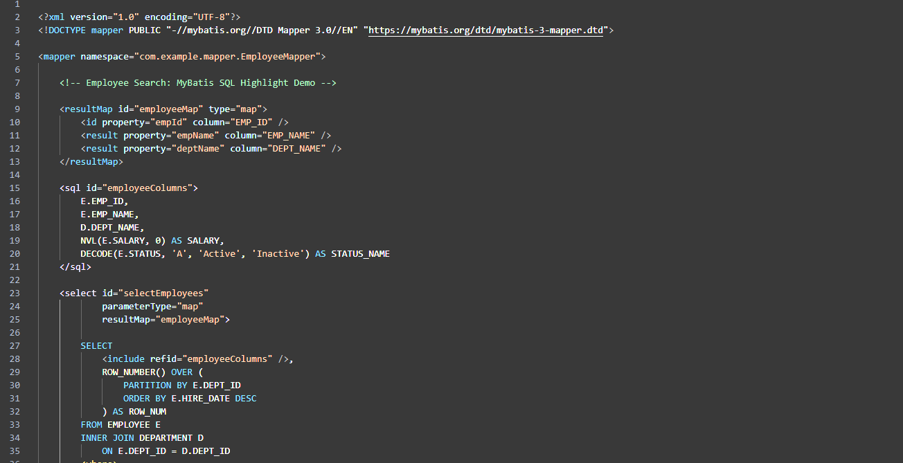
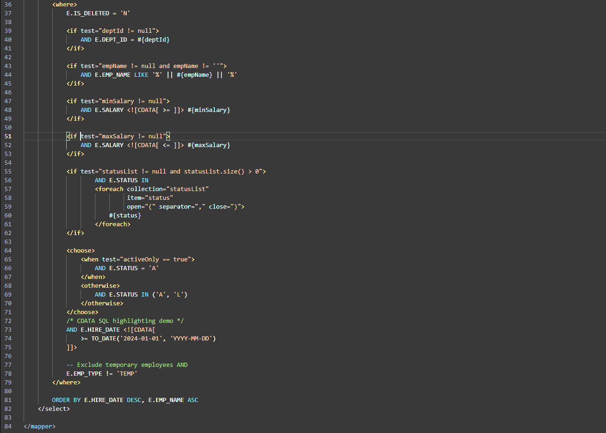

# MyBatis SQL Highlight

Lightweight SQL syntax highlighting for **MyBatis XML mapper files** in Visual Studio Code.

Designed to keep your XML language mode and existing XML tooling while making embedded SQL easier to read. This extension adds editor decorations; it does **not** format or modify your source code.

## Features

### SQL syntax highlighting

Colorizes SQL keywords, common SQL functions (including Oracle functions), identifiers, string and numeric literals, operators, and punctuation.



### MyBatis dynamic SQL and CDATA

Highlights dynamic tags such as `<if>`, `<foreach>`, `<choose>`, `<when>`, `<otherwise>`, and `<where>`; binding expressions (`#{...}` and `${...}`); SQL comments (`--` and `/* ... */`); and SQL inside `<![CDATA[ ... ]]>` sections.



*Screenshots show a fictional employee mapper and do not contain production code.*

### Additional behavior

- Supports unsaved **Untitled** buffers containing a MyBatis `<mapper>` root (XML or Plain Text language mode).
- Preserves the XML language mode for normal `.xml` files, so other XML tools can continue to work.
- Updates highlighting after edits, with debounced refresh and a configurable file-size limit (2 MB by default).
- Configurable colors via VS Code settings.

## Getting started

1. Install **MyBatis SQL Highlight**.
2. Open a `.xml` file with a MyBatis `<mapper>` root, or paste a complete mapper into a new Untitled editor.
3. Highlighting is applied automatically. For unsaved Plain Text buffers, choose XML language mode if you also want native XML features such as Outline.

## Configuration

Search for `mybatisSqlHighlight` in VS Code Settings, or edit `settings.json`:

```json
{
  "mybatisSqlHighlight.enabled": true,
  "mybatisSqlHighlight.keywordColor": "#569CD6",
  "mybatisSqlHighlight.functionColor": "#DCDCAA",
  "mybatisSqlHighlight.stringColor": "#CE9178",
  "mybatisSqlHighlight.numberColor": "#B5CEA8",
  "mybatisSqlHighlight.identifierColor": "#D4D4D4",
  "mybatisSqlHighlight.parameterColor": "#9CDCFE",
  "mybatisSqlHighlight.operatorColor": "#D4D4D4",
  "mybatisSqlHighlight.sqlCommentColor": "#6A9955",
  "mybatisSqlHighlight.commentColor": "#73AD80",
  "mybatisSqlHighlight.statementTagColor": "#B8A1E3",
  "mybatisSqlHighlight.controlTagColor": "#F4B860",
  "mybatisSqlHighlight.maxFileSizeKB": 2048
}
```

Default identifier and operator colors are tuned for dark themes. Adjust them for light themes as needed.

## Limitations

- Syntax highlighting only: **no SQL validation, autocomplete, execution, or formatting**.
- Token recognition is heuristic rather than a full SQL/XML parser; some uncommon syntax or database-specific constructs may be colored imperfectly.
- SQL function highlighting is strongest for common and Oracle-oriented functions; it is not a complete DBMS dialect grammar.
- Files larger than the configured size limit are skipped.
- Other extensions or themes may apply overlapping colors.

## 한국어 안내

**MyBatis SQL Highlight**는 VS Code에서 MyBatis XML Mapper 내부 SQL을 보기 쉽게 색상으로 구분하는 확장입니다.

- SQL 키워드, 함수, 컬럼·테이블명, 문자열, 숫자, 연산자 강조
- `<if>`, `<foreach>`, `<choose>` 등 MyBatis 동적 태그 강조
- `#{...}`, `${...}` 바인딩 파라미터 강조
- CDATA 내부 SQL 및 `--`, `/* ... */` 주석 강조
- 저장하지 않은 새 파일(Untitled)에 Mapper XML을 붙여넣어도 지원
- XML 언어 모드 및 기존 XML 확장 기능 유지

**주의:** SQL 문법 검사, 자동 완성, 자동 포맷팅은 제공하지 않습니다. 다크 테마 기준 기본 색상은 설정에서 변경할 수 있습니다.

## License

[MIT License](LICENSE) — Copyright (c) 2026 Monkie.

## Source and issues

- [GitHub repository](https://github.com/git-monkie/mybatis-sql-highlight)
- [Report an issue](https://github.com/git-monkie/mybatis-sql-highlight/issues)
